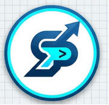

# 🚀 StackPrime Solutions - Linktree

<p align="center">
  
</p>

<p align="center">
  <strong>Cartão de Links & Contatos Profissionais para a Bio do Instagram</strong>
</p>

<p align="center">
  <a href="#-sobre">Sobre</a> •
  <a href="#-tecnologias-utilizadas">Tecnologias</a> •
  <a href="#-funcionalidades">Funcionalidades</a> •
  <a href="#-estrutura-do-projeto">Estrutura</a> •
  <a href="#-autor">Autor</a>
</p>

---

## 📌 Sobre

Página estilo **Linktree** totalmente personalizada e responsiva desenvolvida para a **StackPrime Solutions**. O projeto serve como uma central de contactos e hiperligações para direcionar clientes e parceiros diretamente a partir da Bio do Instagram para os canais oficiais de atendimento, portfólio e redes sociais.

---

## 🛠️ Tecnologias Utilizadas

Este projeto foi construído utilizando as seguintes tecnologias:

- **HTML5:** Estrutura semântica do cartão de links.
- **CSS3:** Estilização moderna utilizando variáveis, Flexbox, Glassmorphism e animações.
- **FontAwesome (v6.5.1):** Ícones vetoriais das redes sociais e ações.
- **Google Fonts (Inter):** Tipografia limpa e moderna.

---

## ✨ Funcionalidades

- 📱 **Design Mobile-First:** Totalmente otimizado para navegação em smartphones e tablets.
- 🎨 **Identidade Visual Personalizada:** Cores baseadas na marca (Azul Escuro e Azul Ciano).
- 💬 **Link Direto do WhatsApp:** Integração com mensagem pré-formatada para orçamentos.
- ⚡ **Indicador de Status:** Badge animado de status online ("Disponível para Projetos").
- 💎 **Efeitos de Hover & Glassmorphism:** Interface interativa com brilhos em ciano ao passar o cursor.

---

## 📁 Estrutura do Projeto

```text
stackprime-linktree/
│
├── index.html
├── README.md
├── css/
│   └── style.css
└── assets/
    └── logo.jpg
